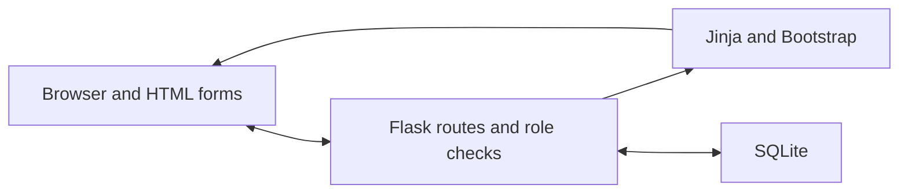
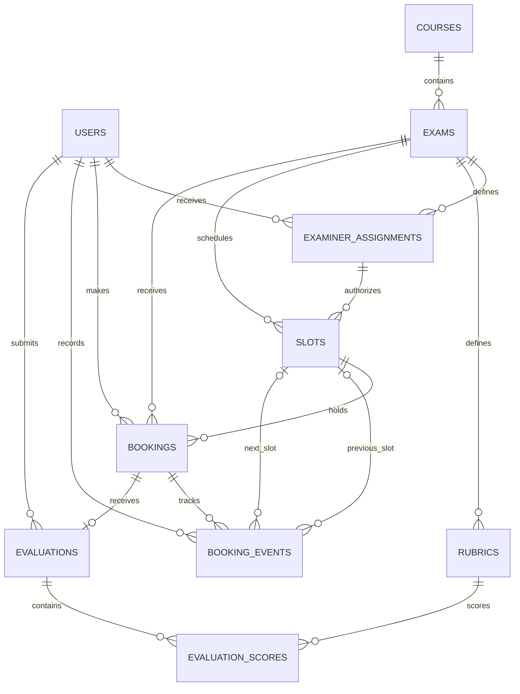

# Examination Management Portal — Architecture

[Plan](plan.md) · [Tracker](tracker.md) · [AI and Git rules](rules.md)

## Stack and approach

Build one locally runnable Flask application in vertical slices. Each slice includes SQLite constraints, a Flask route, a Jinja page and a role-based verification scenario. Flask owns every decision. HTML forms submit actions, Jinja renders the result and locally bundled Bootstrap 5 plus one CSS file style the pages. Use Python's sqlite3 and Werkzeug password hashing. No frontend build step, external datastore or JavaScript dependency for core flows.

## Repository layout

| Path | Responsibility |
|---|---|
| app.py | App factory, configuration, Blueprint registration and shared error handlers |
| db.py, schema.sql | Per-request database connection, schema, foreign keys and initialization CLI |
| auth.py | Login, logout, registration, account lookup and role guards |
| admin.py | Courses, exams, rubric, people, timelines, slots, overrides and publication |
| examiner.py | Assigned exams, slots, rosters and evaluation |
| student.py | Exam browsing, booking, history, results and profile |
| templates/, static/ | Shared layout, role pages, local Bootstrap and app styles |
| instance/ | Local database and excluded runtime files |
| requirements.txt, README.md | Dependencies, Mac setup and repeatable demo instructions |

Suggested CLI commands are `flask --app app init-db` and `flask --app app seed-demo`. Initialization applies the schema and provisions the Admin from local configuration without resetting existing data. Demo seed is separate, repeatable and uses fresh relative dates and fictional records. Store the secret key and bootstrap credentials outside Git. Enable SQLite foreign keys on every connection and close it at request teardown.

## Data model

| Table | Key data and constraints |
|---|---|
| users | ID, unique normalized email, name, password hash, role, account status, contact and department. Examiner starts Pending. |
| courses | ID, unique course code, name, description and archive status |
| exams | Course FK, name, type, duration in minutes, maximum marks, four phase timestamps, phase, archive flag and published timestamp |
| examiner_assignments | Composite key on exam and examiner. Keep historical assignments referenced by slots. |
| rubrics | Exam FK, unique criterion name per exam, criterion maximum and description. Derive percentage weight from maximum marks. |
| slots | Exam and examiner assignment FKs, start/end timestamps, capacity and lifecycle status. Derive Available/Full and remaining seats from booking count. |
| bookings | Student, exam and slot FKs, created timestamp and Booked/Cancelled/Completed status. Composite FK ensures slot belongs to exam. Partial unique index on student and exam for Booked/Completed status. |
| booking_events | Booking FK, actor, action, old/new slot FKs, reason and timestamp. Record creation, cancellation, reschedule and completion in the corresponding transaction. |
| evaluations | Unique booking FK, evaluating examiner FK, total, remarks and submission timestamp |
| evaluation_scores | Evaluation and rubric FKs, awarded marks and composite uniqueness |

## Permissions and workflows

| Role | Routes and actions |
|---|---|
| Admin | Dashboard totals for courses, exams, both user roles, slots and bookings. Course/exam CRUD and historical views, examiner add/approve/deactivate/assign, rubric CRUD, timeline and phase controls, global slot and booking lists, reschedule, replace examiner and publish results. Search people and exams by name/ID and bookings by student name or booking ID. |
| Examiner | Pending accounts see approval status. Approved accounts see assigned exams, own slots, booked students and pending evaluations. Create/manage slots, see own rosters and submit marks. |
| Student | Dashboard with available exams and slots, upcoming bookings and published results. Browse by name, course or type, book/cancel, view schedule/history and edit own profile. |

Use GET for reads and search filters, POST for mutations with CSRF protection, then redirect after success. Store only the user ID in the session and reload account status on each request. Validate role, status, object ownership and submitted IDs on the server. Use parameterized SQL. Role-scoped views fetch only the data users may see.

## Scheduling and record rules

- Use consistent IST timestamps and half-open windows, including the start and excluding the deadline. Require slot creation start < creation end ≤ booking start < booking end. Newly created slots start at or after the booking deadline and end after they start. Default their length to the exam duration.
- Exam phases are Draft, Slot Creation, Booking Open, Closed and Completed. Admin controls the phase. Creation and booking both require the matching phase **and** the corresponding window. Reject timeline edits that would invalidate existing slots or reopen examiner editing after booking began.
- Create slots for approved examiners with an exam assignment. Prevent overlapping active slots for the same examiner. Permit examiner edits/removal before booking starts. Keep any slot referenced by booking history.
- Count Booked and Completed records against capacity. Use `BEGIN IMMEDIATE` for booking and rescheduling so eligibility, capacity, duplicate checks, the write and its event are atomic. Same-exam rebooking is allowed after cancellation if the window still permits it.
- Student cancellation requires a currently Booked record before both the deadline and slot start. Closing new bookings manually leaves the configured cancellation deadline in place.
- Admin can move an unevaluated Booked record to a different future slot in the same exam with free capacity, even after booking closes. Record the reason and both slots. Examiner replacement requires an approved, assigned and available examiner. Preserve existing evaluation authorship.
- Only the currently assigned examiner can evaluate a booked student after the slot ends. Require one valid score per criterion. Criterion maxima must sum to exam maximum. Sum awarded marks, save remarks and mark the booking Completed in one transaction. Freeze scoring criteria and exam maximum after the first evaluation.
- Admin publishes an exam's results after booking has closed and all remaining Booked records have been evaluated. Students see only their own published scores and feedback. Close an elapsed slot when it has no pending evaluations. Archive referenced courses/exams and keep historical access. Delete unused records only when foreign keys allow it.

## UI and demo

Use a neutral Bootstrap layout with white backgrounds, navy primary actions, compact tables and plain status badges. Keep one primary action per page. Use responsive table wrappers, accessible labels and readable validation errors.

Demo exam is DBMS Practical, with Query Correctness 15, Execution 10 and Explanation 5. Use two future slots to show capacity and rescheduling, then a separately seeded past slot to show evaluation and publication. Walk through each action as form → route → permission check → SQL → redirect.
